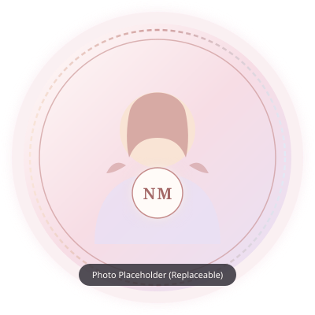

# Nidhikshaa M – Personal Portfolio Website

A modern, elegant, premium-looking and fully responsive personal portfolio website designed for **Nidhikshaa M**, an Aspiring Web Developer. 

Built with pure **HTML5**, **CSS3**, and **Vanilla JavaScript**, this portfolio is tailored for GitHub showcasing, LinkedIn profiles, and internship evaluations.

---

## 🌸 Visual Identity & Pastel Palette

The portfolio features a sophisticated, minimal, and feminine aesthetic with warm ivory, delicate pastel accents, and rose-gold highlights:

| Element / Color | Hex Code | Usage |
| :--- | :--- | :--- |
| **Warm Ivory** | `#FFFBF8` | Primary website background & canvas |
| **Blush Pink** | `#F7DDE5` | Alternating section highlights, soft bubbles, badges |
| **Rose Gold** | `#C58B8A` / `#9F5F5E` | Buttons, icons, decorative borders, active highlights |
| **Lavender** | `#E8E0F5` | About cards, tool chips, category accents |
| **Peach** | `#F9E4D5` | Experience & project accents, skill bubbles |
| **Powder Blue** | `#DFECF7` | Creative tags, category backgrounds |
| **Deep Charcoal** | `#34313A` | Primary typography for contrast and readability |

---

## 📁 Project Structure

```text
Nidhikshaa-Portfolio/
├── index.html                  # Semantic single-page structure & sections
├── css/
│   └── style.css               # Pastel design system, animations, responsive queries
├── js/
│   └── script.js               # Smooth scrolling, mobile drawer, form validation, scrollspy
├── assets/
│   ├── images/
│   │   ├── profile-placeholder.svg   # Centered hero circular profile avatar
│   │   ├── campushub.svg             # CampusHub project mockup illustration
│   │   ├── execusync.svg             # ExecuSync project mockup illustration
│   │   ├── cognifyz.svg              # Cognifyz internship project illustration
│   │   ├── portfolio.svg             # Personal portfolio preview illustration
│   │   └── coming-soon.svg           # Innovative upcoming projects illustration
│   └── icons/
│       ├── github.svg                # GitHub vector icon
│       ├── linkedin.svg              # LinkedIn vector icon
│       ├── mail.svg                  # Mail vector icon
│       ├── external-link.svg         # External navigation icon
│       └── arrow-up.svg              # Back to top icon
└── README.md                   # Complete documentation and setup guide
```

---

## 🌟 Sections Included

1. **Sticky Navigation Bar**
   - Brand logo "Nidhikshaa M" with rose-gold accent dot.
   - Smooth navigation links with active scrollspy indicator.
   - Responsive hamburger menu with animated icon and sliding mobile drawer.
   - Quick GitHub and LinkedIn action buttons.

2. **Hero / Home (Centered Layout)**
   - Top-center circular profile frame with rotating pastel decorative ring and status badge.
   - Elegant serif typography (`Playfair Display`) and modern sans-serif body (`Plus Jakarta Sans`).
   - "Hi, I'm Nidhikshaa!" & "An Aspiring Web Developer".
   - Supporting description & role pill badge.
   - Dual Call-to-Action buttons: **View My Projects** and **Get In Touch**.
   - GitHub & LinkedIn profile links with editable placeholders.

3. **About Me**
   - Professional narrative highlighting web development interests, problem-solving, and continuous learning.
   - 5 structured focus cards: Personal Introduction, Professional Interests, Learning Journey, Web Development Interests, Creative & Technical Synergy.
   - Academic & profile metadata box with editable placeholders for degree, institution, and location.

4. **Technical Skills**
   - Clean category breakdown (no artificial percentages):
     - **Programming and Web Technologies**: HTML5, CSS3, JavaScript, Responsive Web Design.
     - **Development Tools**: Git, GitHub, Visual Studio Code.
     - **Creative Tools**: Canva, Creative Design, Presentation Design.
   - Pastel skill bubbles with custom vector SVGs and hover elevation.

5. **Projects**
   - **CampusHub**: Centralized platform for campus-related information and activities.
   - **ExecuSync**: Organized, user-friendly digital productivity and task synchronization.
   - **Cognifyz Internship Projects**: Practical web development assignments and frontend components.
   - **CodeOrbit Personal Portfolio**: Responsive personal portfolio showcasing technical skills and experiences.
   - **More Projects Coming Soon**: Creative ongoing works and exploration cards.
   - Dedicated SVG illustrations for each project, technology tags, and editable GitHub repo buttons.

6. **Experience & Leadership**
   - Vertical timeline layout with reverse chronological arrangement and connecting pastel gradient stem:
     - **YUVA Club, SKASC** – *Ex-Board Member | Technical Head* (2025–2026, highlighted leadership).
     - **CodeOrbit Tech** – *Web Development Intern* (Internship).
     - **CodeAlpha** – *Full Stack Development Intern* (Internship).
     - **Cognifyz Technologies** – *Web Development Intern* (Internship).
   - Clear distinction between internships and leadership responsibilities.

7. **Contact Me ("Let's Connect!")**
   - Contact channels: Email, LinkedIn, and GitHub with one-click copy buttons.
   - Interactive client-side contact form:
     - Name, Email, Subject, Message.
     - Real-time and submit validation (RFC 5322 email regex, minimum character thresholds).
     - Launches the default email client with a formatted message (`mailto:`).
     - Interactive confirmation feedback card with reset button.

8. **Footer**
   - Brand sign-off and quick navigation links.
   - Social profile icons.
   - Dynamic copyright year calculated via JavaScript (`new Date().getFullYear()`).
   - Signature text: *"Designed with creativity and built with passion."*

9. **Interactive Enhancements**
   - Floating Back-to-Top button (appears when scrolled past 320px).
   - Pastel toast notification system for copied text and form actions.

---

## ✏️ How to Customize Your Details (Editable Placeholders)

All personal placeholders have been clearly marked in `index.html` and `js/script.js`:

1. **Replace Profile Photograph**:
   - Save your photo in `assets/images/` (e.g. `assets/images/nidhikshaa.jpg`).
   - In `index.html` (Hero section around Line 100), change:
     ```html
     
     ```
     to:
     ```html
     
     ```

2. **Update GitHub & LinkedIn Links**:
   - In `index.html`, replace all instances of:
     - `https://github.com/your-username` with your actual GitHub profile URL.
     - `https://linkedin.com/in/your-username` with your actual LinkedIn profile URL.
     - `https://github.com/your-username/CampusHub` with your actual CampusHub repository.
     - `https://github.com/your-username/ExecuSync` with your actual ExecuSync repository.

3. **Update Email Address**:
   - In `index.html` and in `js/script.js` (around Line 275), replace `your.email@example.com` with your real email address.

4. **Update Degree & College Name**:
   - In `index.html` under the **About Me** section (Academic quick facts box), fill in your degree/branch and college name.

---

## 🚀 Running the Project Locally (VS Code Live Server)

1. Open **Visual Studio Code**.
2. Go to **File** → **Open Folder...** and select this directory:
   `c:\Users\nidhi\Documents\internship-2026\CodeOrbit\CodeOrbit_Personal Portfolio`
3. If not already installed, install the **Live Server** extension by *Ritwick Dey* from the VS Code Extensions tab (`Ctrl+Shift+X` and search for "Live Server").
4. Right-click on `index.html` in the Explorer sidebar and click **"Open with Live Server"** (or click **"Go Live"** in the bottom right status bar).
5. Your browser will automatically launch at `http://127.0.0.1:5500/index.html` with real-time reload enabled!

---

## 🌐 Deploying to GitHub Pages

1. Initialize a git repository and commit your files:
   ```bash
   git init
   git add .
   git commit -m "Initial commit: Nidhikshaa M Personal Portfolio"
   ```
2. Create a repository on GitHub (e.g., `nidhikshaa-portfolio`) and push:
   ```bash
   git branch -M main
   git remote add origin https://github.com/<your-username>/nidhikshaa-portfolio.git
   git push -u origin main
   ```
3. In your GitHub repository, go to **Settings** → **Pages** → Source: **Deploy from a branch** → Branch: **main** / **(root)** → Click **Save**.
4. Your portfolio will be live at `https://<your-username>.github.io/nidhikshaa-portfolio/`!
